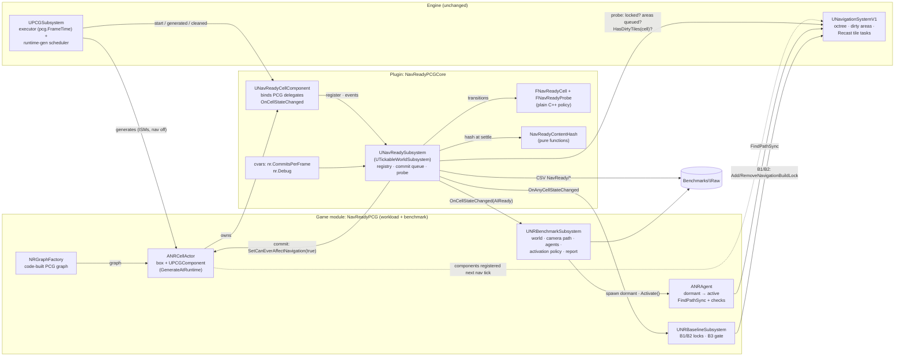

# 02 · System Architecture: NavReadyPCG (v1.0, final)

**Phase:** 3 (Architecture), **final**, 2026-11-21. It replaces the one-line plan in the README; the differences are listed in §14.
**Engine:** UE 5.8.4. Every engine behaviour relied on here is verified in [01b_Research_Findings.md](01b_Research_Findings.md); references like `01b #5` point to its §1 table.
**Rule:** this is the design *before* code (Phase 3). If implementation proves a decision wrong, this file is updated in the same step, and the change is listed in §14.

---

## 1. Goals and non-goals

**Goals**
1. **No AI path through unready content:** an agent in a freshly generated cell gets its first path only after that cell's navmesh tiles are rebuilt from the cell's complete content.
2. **Per cell, not global:** a cell that is still generating never delays a cell that is finished.
3. **One rebuild per cell:** navigation sees a cell's content once, complete, instead of after every partial write.
4. **Bounded work per frame:** at most `nr.CommitsPerFrame` cells are handed to navigation per frame.
5. **A determinism check:** every ready cell carries a hash of its generated content.
6. **Same build, same workload:** the four baselines and the pipeline are switched by command line, with identical generated content.
7. **Reusable core** in a plugin, with its decision logic **testable without a world**.

**Non-goals (v1)**
- Replacing PCG's runtime generation scheduler: it still decides *when* cells generate (§13, rejected alternative 6).
- GPU or componentless PCG output: it has no navigation at all (`01b #2`).
- Several agent sizes (several navmeshes), World Partition, networking: growth paths (§11).
- Production AI (StateTree, AIController, crowd avoidance): v1 agents are minimal measuring agents (§4.2).

## 2. The core idea in plain words

A cell goes through five states:

```text
Idle ──generation starts──▶ Generating ──generation done──▶ Generated ──commit (≤ K per frame)──▶ Committed ──own tiles rebuilt──▶ AIReady
  ▲                                                                                                                                │
  └──────────────────────────── cleaned up / cancelled (from any state); regenerated (AIReady → Generating) ─────────────────────┘
```

1. **Generating.** PCG's runtime scheduler generates the cell as the player approaches. The spawner's mesh entries have *Can Ever Affect Navigation* switched **off**, so the props get collision but navigation ignores them (`01b #5`).
2. **Generated → Committed.** When the cell's PCG component reports "generated", the cell joins a FIFO queue. Each frame NavReady **commits** up to `K` queued cells: it switches *Can Ever Affect Navigation* **on** for each of the cell's generated instance components. The engine then registers them with navigation at the start of the next frame and marks their bounds dirty (`01b #7`).
3. **Committed → AIReady.** Each frame NavReady asks, for every committed cell: has at least one navigation tick run since the commit, are no dirty areas queued, is building not locked, and are no navmesh tiles pending or running **inside this cell's bounds** (`FRecastNavMeshGenerator::HasDirtyTiles(CellBounds)`, `01b #6`)? When all four hold, the cell's content is hashed and the cell becomes **AIReady**. An event tells the game, which activates the cell's agents.

Why this beats a lock: a lock pauses **all** rebuilding (`01b #4`), and its default release throws the whole navmesh away (`01b #3`). A commit touches only one cell's components, at a moment NavReady chooses.

## 3. Modules and where they live

```text
D:\UNREAL PORTFOLIO\P08_NavReadyPCG\NavReadyPCG\            ← the UE project
├── NavReadyPCG.uproject
├── Source\NavReadyPCG\{Public,Private}\                      ← game module: workload, baselines, benchmark only
├── Plugins\NavReadyPCGCore\Source\NavReadyPCGCore\{Public,Private}\   ← the reusable pipeline
└── Config\  Content\
D:\UNREAL PORTFOLIO\P08_NavReadyPCG\Tools\                    ← build/package/smoke scripts, Python stats and run scripts
```

| Module | Type | Responsibility | Depends on |
|---|---|---|---|
| `NavReadyPCGCore` (plugin) | Runtime | Cell registry, commit queue, readiness probe, content hash, AI-ready event, telemetry, cvars | `Core`, `CoreUObject`, `Engine` (public); `PCG`, `NavigationSystem` (private) |
| `NavReadyPCG` (primary game module) | Runtime | World setup, cell actors, the code-built PCG graph, agents and path checks, baselines B1–B3, benchmark director | `NavReadyPCGCore`, `PCG`, `NavigationSystem` |
| `Tools\` | Batch + Python | Build, package, smoke; CSV statistics, interleaved run orchestration with P-core pinning | — |

**The dependency rule:** game → plugin, never the reverse. The plugin knows nothing about agents, baselines or benchmarks.

**Naming:** the plugin is `NavReadyPCGCore` because module names must be unique within a project ([research/04](Research/04_local_engine_verification.md) §0). Public headers use 5.8's export convention: `#define UE_API NAVREADYPCGCORE_API` … `#undef UE_API`.

**Why `PCG` and `NavigationSystem` are private dependencies of the plugin:** its public headers will only forward-declare `UPCGComponent` and never mention navigation types, so modules that include them don't inherit those include paths (`06` §2). If a public header ever needs a PCG type, the dependency moves to public in the same step.

## 4. Classes

### 4.1 Plugin `NavReadyPCGCore` (5 pieces, each with a reason)

| Class | Kind / base | Responsibility | Why it exists, and what we rejected |
|---|---|---|---|
| `ENavReadyCellState` | `UENUM(BlueprintType)` | `Idle`, `Generating`, `Generated`, `Committed`, `AIReady` | One shared vocabulary for code, Blueprint, CSV and the debug view |
| `FNavReadyCell` + `FNavReadyProbe` | Plain C++ structs (no UObject) | **The policy.** `FNavReadyCell` holds the hot per-cell data (state, bounds, timestamps, commit frame, hash) and the transitions: `OnGenerationStarted`, `OnGenerated`, `OnCommitted`, `TrySettle(const FNavReadyProbe&, Now, Frame)`, `OnReset`. `FNavReadyProbe` is plain data the subsystem fills each frame: `bBuildLocked`, `bDirtyAreasQueued`, `bCellHasDirtyTiles` | Makes the state machine and the readiness rule **unit-testable with fake probes, without a world** (S5 tests). *Rejected:* logic inside the subsystem, testable only in a running world (UE5-UpdateBudget made the same split) |
| `NavReadyContentHash` | Free functions in a namespace | `Quantize(const FTransform&)` and `HashCell(TConstArrayView<FNavReadyInstanceKey>)` → `{ ContentHash (order-independent), OrderedHash, NumInstances }` | Pure functions over plain data: testable with hand-made transforms. *Rejected:* hashing raw float bits (one rounding difference between builds would flip it); hashing PCG's internal point data (an engine-internal format that changes between versions) |
| `UNavReadyCellComponent` | `UActorComponent` | The cell. Placed on any actor that owns a `UPCGComponent`. In `BeginPlay` it finds that component, binds its native delegates (start, generated, cancelled, cleaned), captures the cell bounds, and registers with the subsystem; in `EndPlay` it unbinds and unregisters. Exposes `GetState()`, `IsAIReady()`, `GetContentHash()` (`BlueprintCallable`) and `OnCellStateChanged` (`BlueprintAssignable`) | A component, not an actor class: it attaches to whatever actor a project already uses for its PCG content, Blueprint actors included. *Rejected:* an interface (every actor would re-implement the delegate plumbing); a central list the game must fill by hand (easy to forget a cell) |
| `UNavReadySubsystem` | `UTickableWorldSubsystem` (Game and PIE worlds only) | **The mechanism.** Registry (`TArray<FNavReadyCell>` + parallel `UPROPERTY` array of components), the FIFO commit queue, the per-frame tick (commit ≤ K; probe and settle committed cells; hash; broadcast), the readiness probe against the navigation system, CSV telemetry, cvars | Its lifetime is the world, and a tickable runs in the same frame phase as the PCG subsystem (both after `TG_PostPhysics`, `01b #7`). *Rejected:* a manager actor (can be deleted or duplicated); `UGameInstanceSubsystem` (outlives worlds) |

**Console variables** (`ECVF_Default`, because cheat cvars can't be set from config or `-dpcvars`, a rule UE5-UpdateBudget verified):

| Cvar | Default | Meaning |
|---|---|---|
| `nr.CommitsPerFrame` | 1 | Maximum cells handed to navigation per frame (≥ 1) |
| `nr.Debug` | 0 | Draw cell bounds tinted by state, and on-screen counters |

**Telemetry** (CSV category `NavReady`, published once per frame):
- `CellsGenerating`, `CellsQueued`, `CellsCommitted`, `CellsReady`, `CommitsThisFrame`;
- the subsystem's own cost as an exclusive timing stat (`Exclusive/GameThread/NavReady`, subtracted from `Tickables` automatically);
- one native multicast delegate `OnAnyCellStateChanged` for C++ listeners (the baselines and the director).

**What a commit does, precisely:** for each `UInstancedStaticMeshComponent` on the cell's owner that carries PCG's `"PCG Generated Component"` tag (`01b` §2) and can't yet affect navigation, call `SetCanEverAffectNavigation(true)`. If a cell has generated components that were already navigation-relevant, the content was spawned with the flag on: NavReady logs one warning for that cell and continues (the readiness tracking and AI gating still work; only the "one rebuild" benefit is lost). This is SC7's "navigation flag left on" case.

**Readiness probe, precisely:**
```text
NavSys    = UNavigationSystemV1 of the world            (none → not ready)
NavData   = NavSys->GetDefaultNavDataInstance(DontCreate) (none, or not an ARecastNavMesh → not ready)
Generator = NavData->GetGenerator(), cast to FRecastNavMeshGenerator only after the ARecastNavMesh check (none → not ready)
Probe     = { NavSys->IsNavigationBuildingLocked(), NavSys->HasDirtyAreasQueued(), Generator->HasDirtyTiles(CellBounds) }
Settled  ⇔ FramesSinceCommit ≥ 1 ∧ ¬Locked ∧ ¬DirtyAreasQueued ∧ ¬CellHasDirtyTiles
```
The generator is fetched every frame, never cached: a full rebuild can recreate it (`NavigationData.cpp:626`).

### 4.2 Game module `NavReadyPCG` (5 pieces)

| Class | Base | Responsibility |
|---|---|---|
| `UNRBenchmarkSubsystem` | `UTickableWorldSubsystem` (Game/PIE) | The director, acting as the game's "population spawner". Reads `-NR…=` values (configuration, seed, warm-up). Builds the world (floor, navigation bounds, PCG world actor, 16 cell actors; see S1), flies the camera along the fixed path, spawns each cell's agents when the cell's generation completes, **activates them by policy** (B0–B2 at spawn; B3 when the baseline gate opens; NR on the cell's AI-ready event), fires `CSV_EVENT(BenchStart/BenchEnd)`, writes CSV metadata and the run report (per-cell timings, hashes, path results), and exits |
| `ANRCellActor` | `AActor` | A box (the cell bounds, no collision), a `UPCGComponent` (`GenerateAtRuntime`, non-partitioned, seed = base seed + cell index, generation radius overridden), and a `UNavReadyCellComponent`. Nothing else |
| `NRGraphFactory` | Free functions | Builds the one transient `UPCGGraph` in code: Volume Sampler on the cell's box (S1; Create Points Grid can't be used, its settings class isn't exported) → Transform Points → thinning (S2) → Static Mesh Spawner (two meshes, collision `BlockAll`, *Can Ever Affect Navigation* off for NR, on for B0–B3) (`01b` §2: these APIs exist at runtime) |
| `ANRAgent` | `AActor` | A small mesh. **Dormant** until `Activate()`. When active: every 0.5 s of game time, `FindPathSync` to its next seeded target; follows the path kinematically at 3 m/s; checks each result (F1 `Result`, F2 `IsPartial`, F3 a line trace along each segment against the cell's generated props); records results for its first 6 s of activity. No AIController, no CharacterMovement (§13, rejected alternative 10) |
| `UNRBaselineSubsystem` | `UTickableWorldSubsystem` (Game/PIE) | The behaviour NavReady replaces. **B1/B2:** listens to `OnAnyCellStateChanged`; adds `ENavigationBuildLock::Custom` when the first cell starts generating, removes it when none is generating, with `Rebuild` (B1) or `NoRebuild` (B2). **B3:** exposes `IsGlobalGateOpen()` = `!IsNavigationBuildInProgress() && !HasDirtyAreasQueued()`. Inactive in B0 and NR |

## 5. Overview diagram



## 6. Per-frame flow

```mermaid
sequenceDiagram
  participant W as UWorld::Tick
  participant N as UNavigationSystemV1::Tick
  participant A as ANRAgent (TG_PrePhysics)
  participant P as UPCGSubsystem (tickable)
  participant R as UNavReadySubsystem (tickable)
  participant D as UNRBenchmarkSubsystem (tickable)
  W->>N: 1. navigation tick (before tick groups)
  N->>N: process pending octree updates (commits from last frame) → dirty areas
  N->>N: flush dirty areas → mark tiles → submit / collect tile tasks
  W->>A: 2. tick groups: active agents request paths and move
  W->>P: 3. tickables: PCG executor (≤ pcg.FrameTime), then scheduler
  P-->>R: OnPCGGraphGenerated(cell) (via the cell component)
  W->>R: 3. tickables: NavReady
  R->>R: commit ≤ nr.CommitsPerFrame queued cells
  R->>R: probe committed cells; settled → hash → AIReady
  R-->>D: OnCellStateChanged(AIReady)
  D->>A: Activate() the cell's agents (NR)
  R->>R: CSV stats
```

Notes:
- The order *between* tickables is not defined by the engine (`01b` §2). It doesn't matter here: a "generated" event that arrives after NavReady's tick is simply committed next frame.
- A cell committed in frame N is first seen by navigation at the start of frame N + 1. That is why the readiness rule needs `FramesSinceCommit ≥ 1`.

## 7. Defaults and why

| Setting | Default | Reasoning |
|---|---|---|
| `nr.CommitsPerFrame` | 1 | One commit = one cell's components entering the navigation octree (geometry export is `Instant` by default, `01b` §3) plus its dirty areas, in the next navigation tick. At 60 fps that allows 60 cells per second, far above the rate at which cells finish generating. Swept 1 / 2 / 4 / 16 in Phase 8 |
| Commit order | FIFO (generation-complete order) | Simple and fair; PCG's scheduler already generates nearest-first. Priority by distance to the player is a growth path (§11) |
| Readiness rule | §4.1 | Follows directly from `01b #6–#7`. No timers, no guessed delays |
| Hash quantization | location 1 mm, rotation quaternion components 1e-4, scale 1e-3 | Coarse enough to ignore float noise between the editor and packaged builds (instance data is stored as floats relative to the component), fine enough that any real content change alters the hash. The order-dependent hash is reported alongside, to show whether instance *order* is stable (H6) |
| Agents | 8 per cell; a request every 0.5 s of game time; 3 m/s; measured for their first 6 s of activity | 1,536 measured requests per run (> 1,000, SC1). Game time, so every configuration issues identical request timing in fixed-step runs |
| Generation source | the player camera (PCG's default: player controllers are generation sources, `01b` §2) | No extra generation-source component needed |
| Navmesh | `Dynamic`, every other setting at its engine default | `Static` never rebuilds; `DynamicModifiersOnly` can't add navmesh for new geometry (`01b` §3). Defaults keep the result about the engine as shipped |

## 8. Lifetime and safety rules

| Risk | Rule | Evidence |
|---|---|---|
| Editor worlds contain PCG components too | `DoesSupportWorldType`: Game and PIE only. NavReady never commits in an editor world | UE5-UpdateBudget `01b #2` (world subsystems exist in editor worlds) |
| A cell component is destroyed while registered | Unregister in `EndPlay`; `IsValid()` guard in the tick; unbind the PCG delegates in `EndPlay` | UE5-UpdateBudget `01b #8` (GC nulls references only when it runs) |
| A listener destroys a cell (or spawns one) inside `OnCellStateChanged` | Broadcasts happen after the probe loop; registrations and removals during the broadcast are **deferred** and applied after it | same pattern as UE5-UpdateBudget `02` §8 |
| PCG cleans up or cancels a cell mid-pipeline | `OnReset`: state → `Idle`, removed from the commit queue; listeners are told (agents deactivate) | `PCGComponent.h:55–58` (cleaned/cancelled delegates) |
| A ready cell is regenerated | State → `Generating`; before PCG writes, NavReady switches the cell's existing generated components back to navigation-invisible (PCG may reuse managed components), so the new content is again committed once | `PCGActorHelpers.cpp:159–212` (an existing managed ISM component is found and reused) **[inferred that its navigation flag survives]**; tested in S5 |
| No navmesh yet, or not a Recast navmesh | The probe reports "not ready"; nothing is cached | `01b` §3 |
| The generator is recreated by a full rebuild | Fetch it every frame | `NavigationData.cpp:626` |
| Hashing reads instance data | Only on the game thread, once per cell, at settle time | `01b` §2 |
| Hot loop touching UObjects | The per-frame loop reads `FNavReadyCell` data; UObjects are touched only for commits (≤ K per frame) and settle-time hashing | design |

## 9. One workload for every configuration

| Config | Spawner navigation flag | `UNRBaselineSubsystem` | Agent activation (director) |
|---|---|---|---|
| B0 | on | inactive | at spawn |
| B1 | on | lock while any cell generates; release with `Rebuild` | at spawn |
| B2 | on | lock while any cell generates; release with `NoRebuild` | at spawn |
| B3 | on | gate only | when `IsGlobalGateOpen()` |
| NR | **off** | inactive | on the cell's `AIReady` event |

**Measuring readiness in every configuration, at equal cost:** `UNavReadySubsystem` runs in all five. In B0–B3 the content is already navigation-relevant, so a commit finds nothing to switch (a no-op), and the probe simply observes when each cell's tiles are rebuilt. That gives M1 for the baselines with the same code that drives NR. (In B0–B3 the "flag left on" warning is silenced by the director, which knows the configuration.)

## 10. C++ vs Blueprint

| C++ | Blueprint |
|---|---|
| Everything measured: the policy, the probe, commits, hashing, telemetry, agents, baselines, the director | `OnCellStateChanged` (BlueprintAssignable) and `IsAIReady()` / `GetState()` / `GetContentHash()` (BlueprintCallable), so a designer's AI spawner or StateTree task can wait for a cell without C++. Not used by the benchmark |

## 11. How it grows into a production game (not built now)

- **Partitioned and hierarchical runtime generation:** one big PCG component split by the scheduler into local components on pooled partition actors. NavReady then needs a hook for those local components (candidates: a cell component placed by a custom partition-actor class, or observing local-component registration). Investigated when needed, against the engine version then in use.
- **Several agent sizes:** one readiness probe per navigation data (`NavDataSet`), AI-ready when all relevant navmeshes are settled.
- **World Partition dynamic navmesh:** navigation ignores dirtiness from streaming for content already in the base navmesh (`NavigationDirtyAreasController.cpp:135–151`), which a commit must respect; to be investigated with a World Partition map.
- **Dedicated server:** navigation and AI run on the server; the pipeline is server-only. Clients never path.
- **Persistence and networking:** the content hash becomes a save-game or replication key ("this cell generated the same as before"); only player changes need storing.
- **Priority commits:** commit the cell nearest to the player first instead of FIFO.
- **AI frameworks:** a StateTree task or condition "wait for cell AI-ready" for UE5-SquadQuery-style squads.
- **GPU content:** GPU instances have no collision or navigation (`01b #2`); a project mixing GPU scatter with AI would need navigation proxies (modifiers or simple collision) committed the same way.

## 12. Known limits (stated, not hidden)

1. **The content must be spawned navigation-invisible** to get one rebuild per cell. If it isn't, NR still gates AI correctly but navigation rebuilds during generation, like B0.
2. **"Dirty areas queued" is a global check.** A cell can be reported ready about one frame late because of another cell's areas (`01b` B-4).
3. **One navmesh (the default navigation data).** §11.
4. **Readiness means "tiles rebuilt", not "every path is good".** A cell whose props enclose a pocket is navigable but has unreachable points; the path checks exclude those as invalid targets (`01` §6.3).
5. **Other changes inside the cell (a door, a destructible) also delay readiness**, because the probe checks all dirty tiles in the cell. Correct, but worth knowing.
6. **Depends on 5.8.4 behaviour** of PCG component delegates, `SetCanEverAffectNavigation`, `HasDirtyTiles` and the tick order. Pinned and re-verified on any engine change.
7. ~~**The runtime-spawned world is unproven** until S1~~ **Resolved in S1** (`09` S1): a runtime bounds volume with an added box component gets a navmesh (the engine spawns the `RecastNavMesh` itself), and a runtime-spawned `APCGWorldActor` runs the scheduler, both in a packaged build. The editor-scripted map fallback is not needed. Original note: Two parts are at risk: the `APCGWorldActor` (`01b #8`), and the **navigation bounds**. Navigation takes its bounds from each `ANavMeshBoundsVolume`'s component bounding box (`NavigationSystem.cpp:4400–4413`, `GetComponentsBoundingBox(true)`), and a brush volume spawned at runtime has no brush geometry built by the editor **[inferred]**. S1 tests a runtime volume (with an added box component giving it extent) before falling back.

## 13. Rejected alternatives

| # | Alternative | Why we rejected it |
|---|---|---|
| 1 | **Global build lock** while generating (the forum/docs workaround) | Global: one generating cell blocks every finished cell; the default release rebuilds the whole navmesh (`01b #3–#4`). Kept as baselines B1 and B2 |
| 2 | `ANavigationData::SetRebuildingSuspended` | Also global (for that navmesh); doesn't stop builds in progress; past 32,768 areas it rebuilds everything (`01b` §3) |
| 3 | Gate AI on `IsNavigationBuildInProgress` / `OnNavigationGenerationFinished` | Global signals; under continuous generation they arrive late or not at all. Kept as baseline B3 |
| 4 | Wait a fixed delay before activating AI | A timer can't know the load: too short under the burst, wasteful when idle. Its "right" value would come from M1, which NR measures directly |
| 5 | Subclass `ARecastNavMesh` and listen to `OnNavMeshTilesUpdated` | Changes the navigation data class for the whole project, to get information `HasDirtyTiles(FBox)` already provides |
| 6 | Replace PCG's runtime scheduler with our own generation scheduler | Re-implements Epic's priority, pooling and throttling; the comparison would become "our scheduler vs Epic's" instead of "coordinated vs uncoordinated navigation" |
| 7 | `DynamicModifiersOnly` + navigation modifiers on props | Needs a pre-built base navmesh and can't add navmesh for new walkable geometry (forum 2693069). A valid production choice for pure obstacles, but a different problem |
| 8 | A PCG graph authored as an editor asset | A binary asset that needs the editor to read; the code-built graph keeps the whole workload reviewable as text and identical in every run. Cost: an unusual pattern, documented in `05`/`06` |
| 9 | One partitioned PCG component for the whole arena | Its local components are created at runtime on pooled actors, with no runtime delegate to hook (`01b #9`). Growth path (§11) |
| 10 | AIController + CharacterMovement pawns | Path following adds avoidance, re-pathing and movement noise to M4; kinematic agents measure path correctness directly. Real pawns can join the demo later |
| 11 | Poll every cell's tiles from frame 0 (no commit queue) | Gives readiness, but not "one rebuild per cell" or a per-frame bound on navigation work |

## 14. Changes from the README plan (2026-11-21)

| Change | Why |
|---|---|
| "Lock navmesh" replaced by a **per-cell navigation commit** | A lock is global, and its default release rebuilds everything (`01b #3–#5`) |
| "Mark the cell AI-ready" now has a precise, engine-state readiness rule | Engine signals are global; `HasDirtyTiles(FBox)` is per area (`01b #6–#7`) |
| "Procedural instances never affect navigation" corrected; workload uses the CPU spawner with Pawn-blocking collision | `01b #2` |
| "StateTree AI" replaced by minimal measuring agents in v1 | Measures path correctness without movement noise; StateTree is a growth path (§11) |
| Cells are one PCG component each | Runtime delegates exist per component, not per local component (`01b #9`) |
| Baselines defined: B0 uncoordinated, B1 lock + default release, B2 lock + `NoRebuild`, B3 global gate | Each isolates one existing practice (`01` §6.2) |
| Gap strength Medium, not Medium–Strong | `01b` §5 |
| The graph samples the cell's box with a **Volume Sampler** instead of Create Points Grid (S1) | `UPCGCreatePointsGridSettings` isn't exported from the PCG module, so it can't be created from our code (`05` B1) |
| The arena is built 1 km from the world origin; the template map keeps only its lights, sky and player start (S1) | The template's floor sits at the origin; the arena's navigation bounds contain only our geometry (`05` B3) |
| No Detour crowd manager (`CrowdManagerClass=`) (S1) | With a runtime navmesh the default manager warns on every exit; the project has no crowd agents (`05` B5) |
| The cell's generation radius is written through reflection (S1) | `FPCGRuntimeGenerationRadii`'s members are protected in C++ but `BlueprintReadWrite` (`05` B2) |
