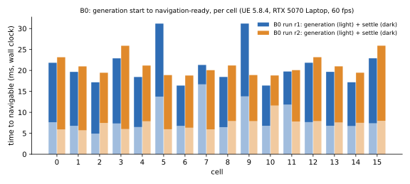

# P08 · NavReadyPCG: runtime generation that's ready to play

**Author:** Krish Gangani · [github.com/KrishGangani](https://github.com/KrishGangani)

**Domain:** Procedural & runtime generation · navigation · **Difficulty:** ★★★★½ · **Engine:** UE 5.8.4

> **Status: closed early (2026-11-21), by the owner's decision.** Phases 1–4 are done (problem analysis, research in the 5.8.4 engine source, architecture, a skeleton that builds and packages with 0 errors and 0 warnings). Phase 5 delivered the runtime world (S1), the 16-cell workload with a per-cell content hash (S2), the readiness observer and the benchmark harness (S3), and NavReady's commit in its smallest form (configuration `NR`). **What is measured:** determinism (16/16 cells, every run, every build), time to navigable for the uncoordinated default B0, and NavReady's own cost. **What is not:** the AI path checks (no measuring agents) and the B1–B3 baselines were cut, and NR's first runs exposed an engine behaviour (an ISM that already has its instances doesn't dirty the navmesh when made navigation-relevant); the fix is written but **not yet verified by a run**. Details: [09](Explanation/09_Testing_And_Benchmarks.md).

| Phase | 1 Problem | 2 Research | 3 Architecture | 4 Foundation | 5 Implementation | 6 Explanation | 7 Testing | 8 Profiling | 9 Review | 10 Portfolio |
|---|---|---|---|---|---|---|---|---|---|---|
| State | ✓ | ✓ | ✓ final | ✓ | closed early: S1–S3 ✓, S5 minimal (fix unverified), S4/S6/S7 cut | ✓ for the final code | partial | one short batch | — | partial (no video) |

---

## Problem statement

When runtime PCG fills a region with props that block movement, AI must not path through that region until the navigation mesh has been rebuilt around them. In UE 5.8.4 nothing coordinates the two (verified in the engine source, [01b](Explanation/01b_Research_Findings.md)):

- **Runtime PCG never uses navigation build locks**, or any navigation API: the PCG module doesn't even depend on the navigation system.
- **CPU-spawned PCG instances do update navigation** when their collision blocks Pawn, on every `AddInstances` call, so the navmesh is rebuilt while a region is still half-generated. (The original plan said "procedural instances never affect navigation"; that is true only for GPU and componentless output, which has no collision or navigation at all.)
- **The engine's readiness signals are global** (`IsNavigationBuildInProgress`, `OnNavigationGenerationFinished`), so a game can't ask "is *this* region ready?".
- **The usual workaround has a trap:** releasing a build lock with its default argument calls `RebuildAll()`, which discards and rebuilds the **whole** navmesh.
- **PCG's frame budget (`pcg.FrameTime`) covers only its graph executor:** the runtime-generation scheduler runs after it and only its cleanup step checks the deadline, and the navigation work the content causes is outside PCG entirely.

The result: agents get paths through rocks the navmesh doesn't know about yet, or wait on unrelated regions. Details: [Explanation/01_Problem_Analysis.md](Explanation/01_Problem_Analysis.md).

## Engineering approach

A per-cell handshake between PCG and navigation: **generate → commit → rebuild → AI-ready → activate AI**.

1. PCG's own runtime scheduler generates each cell, with its props spawned **navigation-invisible** (collision on).
2. When a cell finishes, NavReady **commits** it to navigation (at most one cell per frame by default), so navigation rebuilds that cell's tiles once, from complete content, without a global lock.
3. NavReady watches **that cell's** tiles (`FRecastNavMeshGenerator::HasDirtyTiles(CellBounds)`, after at least one navigation tick) until none are pending or running.
4. It hashes the cell's generated content (a determinism check) and fires the cell's **AI-ready** event; the cell's agents activate only then.

It is compared against four baselines in the same build: uncoordinated (B0), the lock workaround with default arguments (B1), the lock released with `NoRebuild` (B2), and a global readiness gate (B3). Details: [Explanation/02_System_Architecture.md](Explanation/02_System_Architecture.md).

## Main Unreal Engine technologies

PCG runtime generation (the framework is Production-Ready since 5.7; this project uses only its CPU path: runtime scheduler, Create Points Grid, Transform Points, Static Mesh Spawner, none of them labelled Beta or Experimental) · `UNavigationSystemV1` dirty areas and build locks · Recast navmesh (`Dynamic`) and its per-area tile query · `UTickableWorldSubsystem`, `UActorComponent`, delegates · CSV profiler, Unreal Insights. The PCG features labelled Beta or Experimental in 5.8 (GPU processing, the GPU spawner, componentless generation, the interop plugins) are listed in [01b §7](Explanation/01b_Research_Findings.md).

## Architecture diagram

Final (v1.0): [Explanation/02_System_Architecture.md](Explanation/02_System_Architecture.md) §5–6 (mermaid), with the cell state machine in §2.

## Success criteria (targets, defined before implementation)

The full table, with exact thresholds, is in [01_Problem_Analysis.md §6.4](Explanation/01_Problem_Analysis.md). In short:

- **AI never paths through unready content:** 0 path failures per 1,000 requests near fresh content, in every run.
- **Determinism:** 100% hash match per cell across runs, configurations and builds.
- **Time-to-navigable per cell** no worse than the uncoordinated default (≤ 1.10× its median), and at most half the default workaround's p95.
- **Time-to-AI-active** at most half the global gate's median during a burst of generation.
- **Worst frame during generation** no worse than the uncoordinated default.
- **Overhead** ≤ 0.05 ms per frame (median).

## Before / after comparison

Planned: five configurations (B0, B1, B2, B3, NR). Run: **B0 vs NR only**, one short batch, and the NR runs are not valid (their props never reached the navmesh; `09`). So there is **no before/after claim** for readiness, path correctness or frame time.

## Benchmark results

Batch `2026-11-21_111841_final`: packaged Development build, real time capped at 60 fps, RTX 5070 Laptop, 1280×720, pinned to the P-cores (mask 0xFFFF), 2 runs per configuration + priming. Raw data and summary in [Benchmarks/](Benchmarks/README.md).

| Measured | Result |
|---|---|
| **Determinism (SC2)** | ✅ Same seed → the same content hash in **16/16 cells**, run to run, with and without the GPU, cooked and uncooked, and in B0 and NR; another seed changes 16/16 |
| **B0 time to navigable per cell (M1)** | median **20.1 ms** [19.7–20.5], p95 **28.5 ms** [25.9–31.2] (generation start → the cell's tiles rebuilt, wall clock) |
| **NavReady's own cost (SC6)** | median **0.003 ms**, max **0.19–0.33 ms** per frame in all four runs (target: median ≤ 0.05, max ≤ 0.50) ✅ |
| B0: ready cells re-dirtied by a neighbour's edge props | 32–35 episodes per run: why per-cell readiness must watch neighbours (`12`) |
| AI path failures (SC1), time to AI-active (SC4), worst frame (SC5), NR's readiness (SC3) | **not measured** |



## Existing work it is compared against

PCG's runtime generation scheduler and `pcg.FrameTime`; the Dynamic navmesh; navigation build locks and Epic's documented `bInitialBuildingLocked` / `ReleaseInitialBuildingLock()` pattern; `SetRebuildingSuspended`; the engine's global readiness signals; Dynamic Modifiers Only with navigation modifiers; GPU and FastGeo output (no navigation at all); the Epic forum suggestion to lock navigation while PCG runs and rebuild the dirty areas afterwards (a one-line suggestion with no code). Details and sources: [01b §5](Explanation/01b_Research_Findings.md) and [Phase2_Raw_Notes/C_existing_work.md](Explanation/Phase2_Raw_Notes/C_existing_work.md).

**The gap it targets:** a per-region handshake from generated content to AI-ready navigation, with a frame bound and a determinism check, measured against the existing practices. **Gap strength: Medium.** The plan said Medium–Strong; research lowered it, because every building block is a public engine API. The value is in assembling them correctly and measuring honestly.

**Main risks:** Dynamic navmesh cost; PCG API churn between versions (everything is pinned to 5.8.4); a runtime-spawned PCG world actor (resolved in step S1: it works in a packaged build, so the scripted-map fallback isn't needed).

## Why studios care

CD PROJEKT RED's AI roles ask for "spawning and systemic open world", "procedural content generation" and "core navigation, pathfinding, and avoidance systems, with a focus on scalability and open world performance"; Rocksteady for "coordinating combat-related and navigation related NPC behaviours"; Rockstar North for "open-world, population and streaming systems". Honest scope: AI and navigation appear in 20 of 57 sampled postings, procedural generation in 1. Sources: [Explanation/Research/01_job_market.md](Explanation/Research/01_job_market.md).

## Source code

The UE project is in [NavReadyPCG/](NavReadyPCG/) (UE 5.8.4, C++):
- the reusable system is the plugin `NavReadyPCGCore`;
- the workload, baselines and benchmark code are in the game module `NavReadyPCG`.

## Documentation

| File | Contents |
|---|---|
| [00_Project_Overview](Explanation/00_Project_Overview.md) | Identity, demonstration, presentation, industry relevance |
| [01_Problem_Analysis](Explanation/01_Problem_Analysis.md) | Problem, existing work, root-cause hypotheses, workload, configurations, metrics, success criteria, measurement plan |
| [01b_Research_Findings](Explanation/01b_Research_Findings.md) | Phase 2: verified engine behaviour (UE 5.8.4), the README claims checked, PCG feature maturity, and what it changed in the design |
| [02_System_Architecture](Explanation/02_System_Architecture.md) | Final v1.0: modules, classes, the cell pipeline, per-frame flow, safety rules, rejected alternatives |
| [03_Implementation_Roadmap](Explanation/03_Implementation_Roadmap.md) | The small, ordered build steps; baselines captured before the pipeline exists |
| [04](Explanation/04_CPP_Fundamentals.md) · [05](Explanation/05_Line_By_Line_Code_Explanation.md) · [06](Explanation/06_Unreal_APIs_And_Macros.md) · [07](Explanation/07_Common_Mistakes.md) | C++ fundamentals, line-by-line code, APIs and macros, common mistakes. Written step by step with the code (current to the final code) |
| [09](Explanation/09_Testing_And_Benchmarks.md) | Every check and benchmark batch so far |
| [08](Explanation/08_Debugging_And_Profiling.md) · [10](Explanation/10_Interview_Questions.md) · [11](Explanation/11_Optimization_Decisions.md) · [12](Explanation/12_Future_Scalability.md) | Debugging and profiling, interview questions, optimisation decisions, future scalability. 08 and 11 not written; 10 and 12 written |
| [Phase2_Raw_Notes/](Explanation/Phase2_Raw_Notes/README.md) | The audit trail behind 01b |
| [Research/](Explanation/Research/) | The portfolio-wide research this project draws on: job market, technical challenges, existing solutions, local engine verification |

## Folder layout

```text
P08_NavReadyPCG\
├── README.md        ← this page
├── Explanation\     ← 00–12, Phase 2 raw notes, research copies
├── Benchmarks\      ← Raw\ + Summaries\, and the run protocol
├── Media\           ← diagrams, screenshots, demo video
├── Tools\           ← build, package, smoke and check scripts; CPU pinning; (S3) statistics and run scripts
└── NavReadyPCG\     ← the Unreal Engine project (.uproject, Source, Plugins, Config, Content)
```

## License

MIT, see [LICENSE](LICENSE). Unreal Engine itself is not included and is covered by Epic Games' own license.
